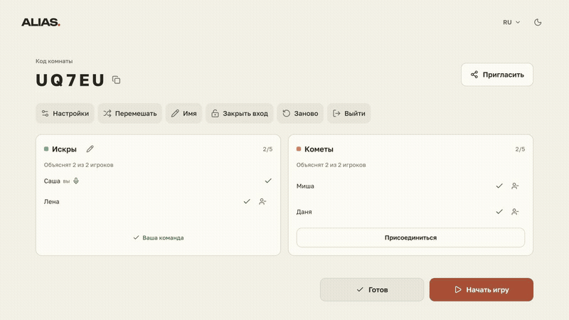
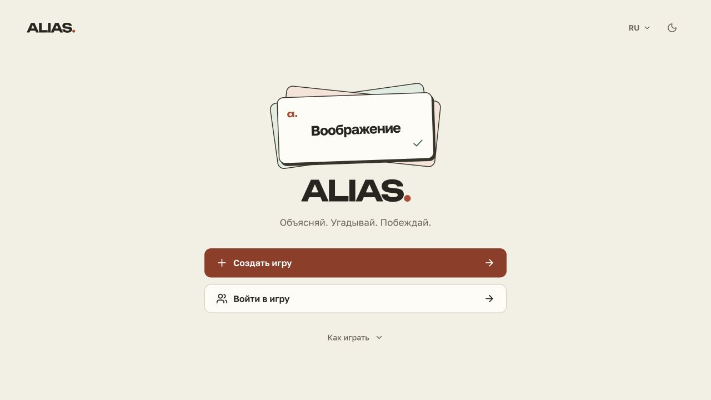
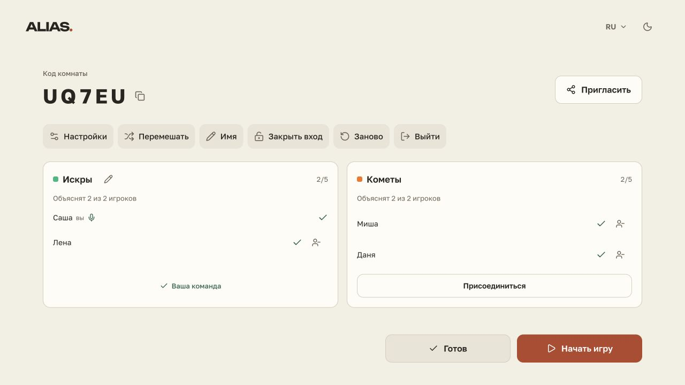
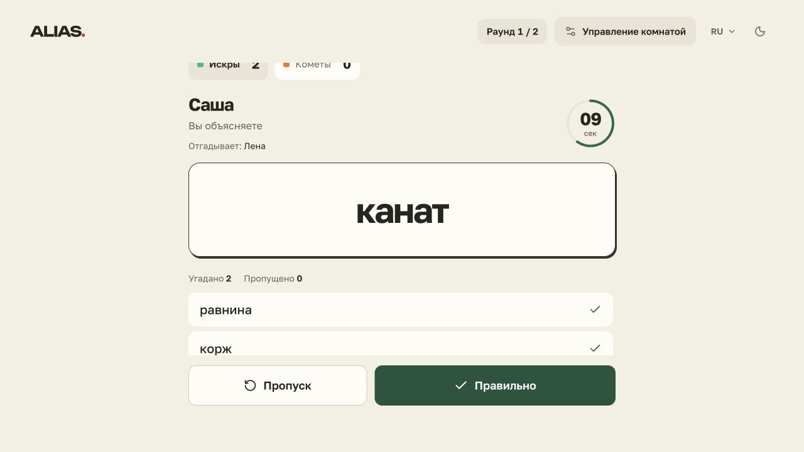
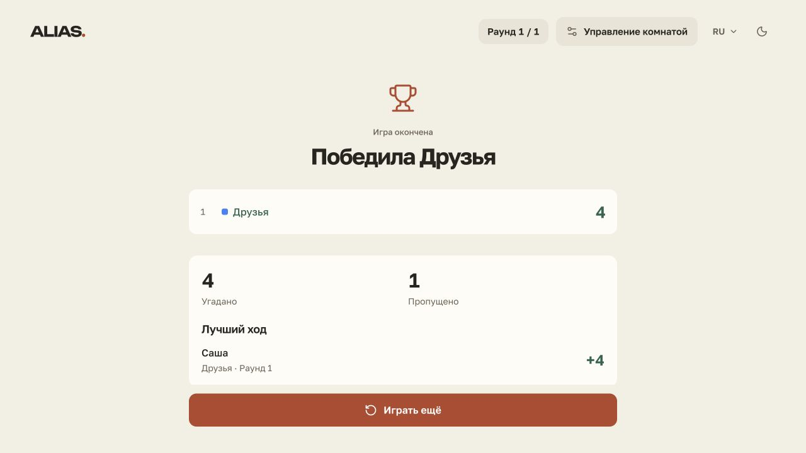
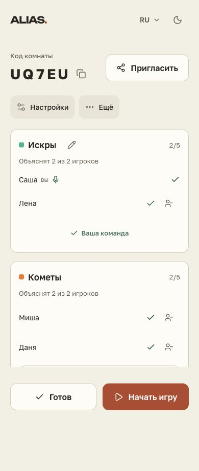
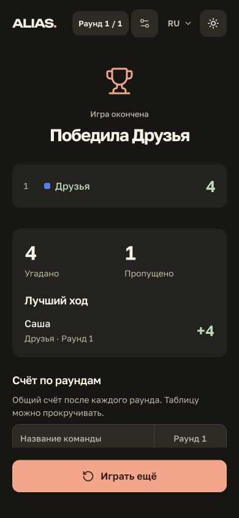

# ALIAS

### Объясняй словами. Угадывай командой.

Игра для вечера с друзьями — прямо в браузере, на телефоне или компьютере.

**[Играть →](https://aliasgo.vercel.app/)** · [Как начать](#как-начать) · [Скриншоты](#скриншоты) · [Обратная связь](https://github.com/cleave173/alias-game/issues)

Без регистрации · Комнаты по ссылке · Светлая и тёмная темы

---

Один игрок видит слово и объясняет его своей команде, не называя само слово и однокоренные. Остальные стараются угадать как можно больше до конца хода. За правильный ответ команда получает очко, за пропуск — ноль. Побеждает команда, набравшая больше очков за все раунды.

**Alias берёт на себя карточки, таймер, очередь ходов и подсчёт очков — вам остаётся играть.**

## Посмотрите, как это выглядит

Карточка слова, правильные ответы, пропуски и итог хода. **[Открыть видео MP4](assets/demo/gameplay.mp4)**.

## Как начать

1. **[Откройте игру](https://aliasgo.vercel.app/)** и введите имя. Аккаунт и установка приложения не нужны.
2. **Создайте комнату.** Выберите команды, длительность хода, число раундов и сложность слов.
3. **Пригласите друзей** по ссылке или коду комнаты и распределитесь по командам.
4. **Подтвердите готовность.** Когда все готовы, назначенный объясняющий запускает ход.
5. **Объясняйте и угадывайте.** Объясняющий отмечает ответы кнопками «Правильно» и «Пропуск». После хода посмотрите слова и передайте очередь следующему игроку.

За одним столом можно играть с одного устройства: выберите одну команду и передавайте телефон объясняющему. Для игры на расстоянии откройте комнату на своих устройствах и созвонитесь в привычном мессенджере.

## Что можно настроить

| Настройка | Возможности |
| --- | --- |
| Команды | От 1 до 10; собственные названия и распределение игроков |
| Время хода | От 15 секунд до 10 минут |
| Раунды | От 1 до 10; в каждом раунде каждая команда получает один ход |
| Сложность | Easy, Normal, Hard, Insane или смешанная подборка |
| Слова | Русский словарь и собственные подборки |
| Интерфейс | Русский и английский языки, светлая и тёмная темы |

Язык интерфейса выбирается отдельно от языка слов: участникам не обязательно использовать одинаковые настройки экрана.

## Детали, которые помогают играть

- **Слово видно объясняющему.** На остальных устройствах участники следят за ходом и счётом, а текущая карточка остаётся скрытой.
- **Старт, когда все готовы.** Между ходами можно спокойно обсудить результат и подготовиться.
- **Ошибку можно поправить.** До перехода к следующему ходу или финалу участники сыгравшей команды могут исправить отметку «угадано / пропущено».
- **Результаты с подробностями.** Итоговый экран показывает счёт, лучшие ходы, результаты по раундам и историю слов. Карточку результатов можно сохранить изображением.
- **Возврат в комнату.** При временном обрыве связи или обновлении страницы игра пытается восстановить вашу сессию, пока комната и сессия доступны.
- **Управление компанией.** Владелец комнаты может закрыть вход для новых участников, убрать игрока и начать новую партию в том же лобби.

## Скриншоты

### От приглашения до первого слова

| Главная страница | Команды в лобби |
| :---: | :---: |
|  |  |

| Игровой ход | Результаты партии |
| :---: | :---: |
|  |  |

### На телефоне и в тёмной теме

  
  &nbsp;&nbsp;
  

Снимки и видео показывают демонстрационные партии, включая игру с одного устройства. Имена участников используются для примера.

## Частые вопросы

**Нужно ли скачивать приложение?**

Нет. Откройте [сайт](https://aliasgo.vercel.app/) в браузере.

**Можно ли играть своей подборкой?**

Да, при настройке комнаты можно указать собственные слова.

**Можно ли сменить язык?**

Интерфейс доступен на русском и английском. Основной встроенный словарь — русский; для своей тематической или языковой подборки добавьте собственные слова.

**Это репозиторий с исходным кодом?**

Это публичная витрина проекта: описание, скриншоты и видео. Исходный код приложения здесь не публикуется. Чтобы попробовать игру, переходите на сайт — клонировать репозиторий не требуется.

## Обратная связь

Нашли ошибку или придумали улучшение? **[Создайте issue](https://github.com/cleave173/alias-game/issues/new)**. Для ошибки укажите устройство и браузер, шаги воспроизведения и ожидаемый результат. Скриншот поможет разобраться; не прикладывайте личные данные и ссылки на действующие приватные комнаты.

Автор проекта — **[cleave173](https://github.com/cleave173)**.

---

**Соберите команду. Первое слово уже ждёт.**

### [Открыть Alias →](https://aliasgo.vercel.app/)

